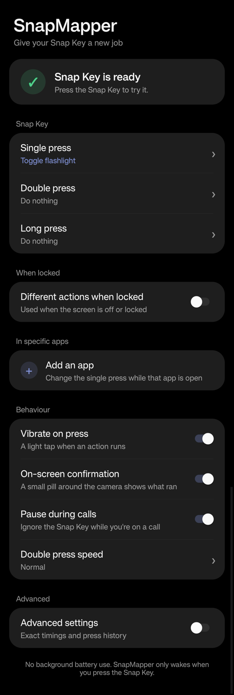
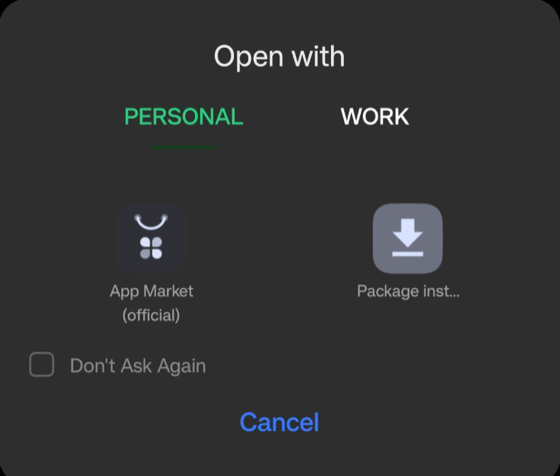

<p align="center">
  
</p>

<h1 align="center">SnapMapper</h1>

<p align="center">
  <b>Give the Snap Key on your OPPO phone a new job.</b><br>
  Single, double and long press, each with its own action.
</p>

<p align="center">
  <a href="../../releases/latest"><b>⬇ Download SnapMapper.apk</b></a>
</p>

<p align="center">
  
</p>

- **A normal app — no accessibility service, no root, no internet.** It works fine alongside
  banking and payment apps (Google Pay included).
- **No computer needed.** Install it straight on the phone.
- **Tiny** (~100 KB) and open source (MIT).
- **No background battery drain.** It only does work when you press the Snap Key.

> [!IMPORTANT]
> **Set your Snap Key to "Translate".** After installing, open
> **Settings → Snap Key** and choose **Translate**. That's how ColorOS hands the Snap Key to
> SnapMapper. If it's set to anything else, SnapMapper never receives your presses.

---

## Contents

- [Quick start](#quick-start)
- [What it can do](#what-it-can-do)
- [Which phones](#which-phones)
- [Install, step by step](#install-step-by-step)
- [Screenshots (and why they don't break Google Pay)](#screenshots)
- [Choosing actions (read this: long press)](#choosing-actions)
- [Permissions and privacy](#permissions-and-privacy)
- [Troubleshooting](#troubleshooting)
- [How it works](#how-it-works)
- [Limitations](#limitations)
- [Uninstall](#uninstall)
- [Build from source](#build-from-source)
- [Credits and license](#credits-and-license)

---

## Quick start

1. **Uninstall ColorOS Translate** if your phone has it.
2. **Download** [`SnapMapper.apk`](../../releases/latest) on the phone.
3. Open it from **My Files → Downloads** and choose **App Market (official)**, not "Package
   installer". If it shows a security scan, tap **Install anyway**.
4. **Settings → Snap Key → Translate.**
5. Open SnapMapper, pick your actions. (Screenshot asks for a one-time permission the first time.)

That's it — no accessibility, no computer.

---

## What it can do

**Three gestures:** single press, double press and long press, each with its own action.

| Category | Actions |
|---|---|
| **Quick toggles** | Flashlight · Switch ring / vibrate · Cycle ring / vibrate / silent |
| **Capture** | Take screenshot · Open camera · Record video |
| **Open** | Any app · A link · Voice assistant · Web search · Start a timer · Go home |
| **Media** | Play / pause · Next track · Previous track |
| **System** | Lock screen |

**Smart behaviour**

- **Different actions when locked.** A separate set for when the screen is off or locked.
- **Per-app actions.** Change the single press while a chosen app is open.
- **Pause during calls.** The Snap Key is ignored while you're on a call.
- **Feel the result.** Vibrate = one long strong buzz, ring = two short buzzes.
- **On-screen confirmation (optional).** A small pill around the camera shows what ran.
- **Advanced:** exact double-press window, press history.

The settings screen follows the ColorOS look: large title, rounded cards, light and dark mode.

---

## Which phones

Tested on the **OPPO Find X9 Ultra** (CPH2841, ColorOS 17). Should also work on other OPPO /
OnePlus phones with a Snap Key, **as long as the ColorOS Translate app can be uninstalled or
isn't installed**. See [How it works](#how-it-works).

---

## Install, step by step

### 1. Remove ColorOS Translate (if you have it)

SnapMapper takes the place of the ColorOS Translate app, so the two can't be installed together.
**Settings → Apps → App management → Translate → Uninstall.** Don't see Translate? Skip this.

### 2. Download the app

On the phone, open the [latest release](../../releases/latest) and download **`SnapMapper.apk`**.

### 3. Install it with App Market

Open **My Files → Downloads**, tap **SnapMapper.apk**, and choose **App Market (official)**:

<p align="center">
  
</p>

It scans the app; tap **Install anyway**.

> **Why App Market and not "Package installer"?** SnapMapper uses the package name
> `com.coloros.translate` (see [How it works](#how-it-works)). ColorOS only lets apps with an
> OPPO-style package name be installed by an app store. App Market is OPPO's store, so ColorOS
> accepts it. "Package installer" fails with **"App not installed"**.

### 4. Set the Snap Key to "Translate"

Open **Settings → Snap Key** and choose **Translate**. SnapMapper now receives the Snap Key in
place of the Translate app.

### 5. Pick your actions

Open SnapMapper and choose an action for each gesture. If you pick **Screenshot**, it shows a
one-time "Set up screenshot" step (see below). **Lock screen**, the **camera pill** and
**per-app actions** each ask for their own one-time permission only if you use them.

---

## Screenshots

SnapMapper takes screenshots through Android's **screen-capture API** (MediaProjection) — the
same one screen recorders use — **not** through an accessibility service. That's deliberate:
payment apps like Google Pay refuse to run while a sideloaded accessibility service is on, and
SnapMapper has none, so **Google Pay keeps working**.

The first time you use the screenshot action, Android asks for screen-capture permission once.
To avoid asking again on every screenshot, SnapMapper keeps a quiet, ongoing notification while
screenshot mode is armed (that's how all screenshot apps hold the permission). Turn it off any
time from the notification or from SnapMapper's status card.

---

## Choosing actions

**Use single and double press for anything you do while typing. Use long press for actions that
open something.**

On a **single or double press**, ColorOS sends SnapMapper a silent background message — nothing
on screen changes. On a **long press**, ColorOS opens a tiny invisible SnapMapper screen (that's
how it handles long presses for the Translate slot). It closes instantly, but if the keyboard is
open it **briefly flickers**.

| Good for long press | Better on single / double press |
|---|---|
| Open camera / record video | Switch ring / vibrate |
| Open an app or a link | Cycle ring / vibrate / silent |
| Take screenshot | Toggle flashlight |
| Voice assistant, web search, timer | Play / pause, next / previous track |
| Lock screen, go home | Anything you use while typing |

Opening apps, the camera and links is most reliable on **long press** — a long press runs from a
real foreground screen, while a single tap runs from the background, which Android sometimes
won't let launch another app.

---

## Permissions and privacy

SnapMapper is a normal app. **No accessibility service. No internet permission** — nothing it
does can leave your phone. You only grant a permission for the specific action that needs it:

| Permission | When | Why |
|---|---|---|
| Vibration | always | Haptic feedback (granted automatically) |
| Screen capture | if you use **Screenshot** | Take the screenshot, via the system capture API |
| Notifications | with screenshot | The ongoing "screenshot armed" notice |
| Display over other apps | if you turn on the **camera pill** | Draw the little confirmation pill |
| Usage access | if you add **per-app actions** | Read only which app is in front |
| Device admin (lock) | if you use **Lock screen** | Call the system lock; nothing else |

No accessibility, so no screen reading and no payment-app conflicts. Settings and press history
stay on the phone. The full source is in this repository.

---

## Troubleshooting

**"App not installed" when installing** — you used "Package installer". Open the APK from My
Files again and choose **App Market (official)**. Uninstall ColorOS Translate first if present.

**Pressing the Snap Key does nothing** — the Snap Key must be set to **Translate**
(Settings → Snap Key). Check the action isn't "Do nothing", and that "Pause during calls" isn't
stopping it. Open SnapMapper: the status card says what's missing.

**Screenshot asks for permission every time** — allow it to keep the "screenshot armed"
notification; that's what lets it skip the prompt. If ColorOS killed the app, open SnapMapper
once to re-arm. After a reboot you set it up again.

**The keyboard flickers on long press** — expected; see [Choosing actions](#choosing-actions).
Move that action to single or double press.

**Opening an app on single press does nothing** — Android blocks background app launches; put
"open app" on long press instead.

---

## How it works

ColorOS doesn't let normal apps see the Snap Key directly — the button isn't mapped to an
Android key code. Instead ColorOS runs whatever function you pick in **Settings → Snap Key**,
and each function names an **owner app**. For **Translate**, the owner is `com.coloros.translate`:
on a tap ColorOS sends a message to `com.coloros.translate/.ui.cube.KeyMessengerService`, and on
a long press it starts an activity in that package.

SnapMapper uses the package name `com.coloros.translate` and provides exactly that service and
activity, so ColorOS delivers every Snap Key press to it. It accepts presses only from
`com.oplus.gesture`, then works out single / double / long and runs your action.

**No accessibility service.** Everything runs as a normal app: flashlight, ringer, media and
launches are plain framework calls; **screenshots** use the MediaProjection screen-capture API;
**lock screen** uses a device-admin lock. This is why Google Pay and banking apps are happy —
there's no accessibility service for them to object to.

**Installing:** ColorOS blocks sideloaded apps that use an OPPO-style package name unless an app
store installs them, so you install through OPPO's App Market.

---

## Limitations

- **Snap Key must stay on "Translate".** Any other function sends presses back to ColorOS.
- **Long press flickers the keyboard** if it's open.
- **Screenshot needs re-arming after a reboot** (one tap), and keeps a quiet notification while
  armed.
- **If OPPO reinstalls Translate** (e.g. a system update), it conflicts with SnapMapper; remove
  it and reinstall SnapMapper.
- Tested on the ColorOS version above; others are untested.
- Updates must be signed with the same key; if you build it yourself, uninstall the release
  version first.

---

## Uninstall

1. **Settings → Apps → SnapMapper → Uninstall.**
2. **Settings → Snap Key:** choose any other function.
3. Optional: reinstall **Translate** from App Market.

---

## Build from source

Requirements: JDK 17 and the Android SDK (platform 35).

```bash
git clone https://github.com/amarsakore/SnapMapper.git
cd SnapMapper
./gradlew assembleRelease
```

The APK lands in `app/build/outputs/apk/release/app-release.apk`. Install it the same way as the
release (App Market).

| File | What it does |
|---|---|
| `…/coloros/translate/ui/cube/KeyMessengerService.kt` | Receives single taps from ColorOS |
| `…/coloros/translate/ui/cube/LongPressActivity.kt` | Receives long presses |
| `…/amar/snapmapper/PressEngine.kt` | Gesture detection + runs actions + the camera pill |
| `…/amar/snapmapper/KeyAction.kt` | All actions and their haptics |
| `…/amar/snapmapper/CaptureService.kt` | Screenshots via MediaProjection |
| `…/amar/snapmapper/MainActivity.kt` | The settings screen |

Issues and pull requests welcome.

---

## Credits and license

Inspired by [KeySnap](https://github.com/Nicholas-Arda/KeySnap). No code from KeySnap is used.

SnapMapper isn't affiliated with or endorsed by OPPO. "OPPO", "ColorOS" and "Snap Key" are
trademarks of their owners.

Released under the [MIT License](LICENSE).
